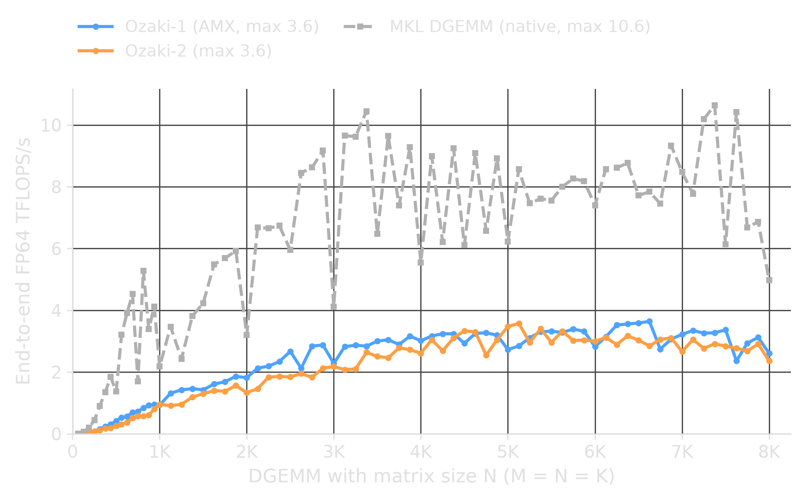
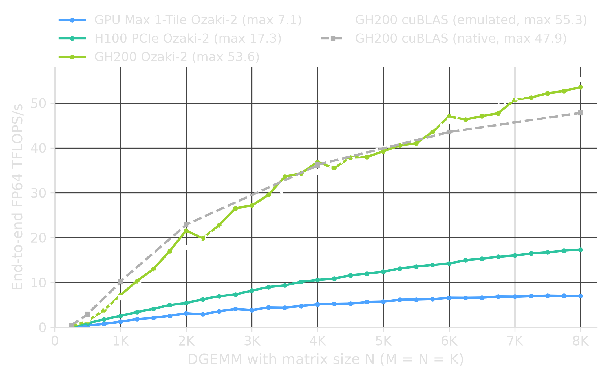

# Practical Ozaki Schemes

## High-Precision GEMM via Low-Precision Hardware

LIBXS and LIBXSTREAM

---

## Latest Revision of the Slides

https://libxs.readthedocs.io/ozaki/

---

## INT8 and FP64 on the Same Part

| Part             | FP64 (TFLOPS/s) | INT8 (TOPS/s) | Ratio |
|------------------|-----------------|---------------|-------|
| GPU Max 1550     | 52              | 1678          | 32×   |
| H100 PCIe        | 51              | 1513          | 30×   |
| H100 SXM / GH200 | 67              | 1979          | 30×   |

Data-sheet peaks of the matrix engines, dense (no sparsity).

---

## Fairness: Matrix Engines

- Fair: INT8 against FP64, both on matrix engines
- Unfair: INT8 matrix engine against scalar FP64
- Scalar units add register and scheduling overhead

Ozaki targets the matrix engines:
VNNI/AMX on CPU, DPAS and tensor cores on GPU.

---

## Hardware Targets

| Target        | Instruction          | Operands | Use                   |
|---------------|----------------------|----------|-----------------------|
| AVX-512 VNNI  | VPDPBUSD             | u8 × s8  | CPU default           |
| AVX-512 INT8  | VPDPBSSD, VPDPBUUD   | s8, u8   | where available       |
| AMX           | TDPBSSD, TDPBUUD     | s8, u8   | auto (`OZAKI_AMX`)    |
| Intel Xe      | DPAS                 | u8/s8    | default               |
| NVIDIA        | dp4a                 | u8/s8    | without MMA           |
| NVIDIA        | mma.sync, wgmma      | u8/s8    | default if supported  |

The integer kernels are our own; no vendor BLAS is called for them.

---

## What Is Ozaki?

Replaces BLAS GEMM with low-precision integer arithmetic.

- Scheme 1: mantissa slicing, up to S(S+1)/2 integer GEMMs
- Scheme 2: residues and CRT, P integer GEMMs plus reconstruction
- Adaptive (default): one scheme per call, by shape and hardware

Optional statistics compare against the original BLAS call.

---

## How It Works

```text
Application calls DGEMM/SGEMM/ZGEMM/CGEMM
            │
            ▼
    libwrap.so intercepts the call (LD_PRELOAD)
            │
            ▼
    Decompose FP values into int8 slices or byte residues
            │
            ▼
    Integer matrix products (VNNI/AMX, DPAS, dp4a/MMA)
            │
            ▼
    Reconstruct full-precision result
```

---

## Build

```bash
git clone https://github.com/hfp/libxstream.git
git clone https://github.com/hfp/libxs.git

cd libxs/samples/ozaki
make -j $(nproc)
```

Produces `libwrap.so`, `libwrap.a`, and test drivers
(`dgemm-wrap.x`, `sgemm-wrap.x`, `zgemm-wrap.x`, `cgemm-wrap.x`).
The sibling `libxstream` directory adds the GPU path.

---

## Quick Sanity Check

```bash
./dgemm-wrap.x 256
```

```text
dgemm('N', 'N', 256/*m*/, 256/*n*/, 256/*k*/,
  1/*alpha*/, 0x7cf7c8a02010/*a*/, 256/*lda*/,
              0x7cf7c8981010/*b*/, 256/*ldb*/,
   1/*beta*/, 0x7cf7c8900010/*c*/, 256/*ldc*/)
OZAKI GEMM: <time> ms (<rate> GFLOPS/s)
BLAS GEMM:  <time> ms (<rate> GFLOPS/s)
```

---

## Deploy via LD_PRELOAD

```bash
LD_PRELOAD=/path/to/libwrap.so ./your_application
```

DGEMM/SGEMM/ZGEMM/CGEMM calls are intercepted automatically.

No recompilation needed.

---

## MPI: Getting LD_PRELOAD Right

The wrapper must reach every MPI rank, not just mpirun itself.

### Wrong (wrapper only in the launcher process)

```bash
LD_PRELOAD=libwrap.so mpirun -np 4 ./app
```

### Correct (wrapper propagated to each rank)

```bash
mpirun -np 4 env LD_PRELOAD=/path/to/libwrap.so ./app
```

---

## SLURM and MPI

- SLURM: `srun -n 4 --export=ALL,LD_PRELOAD=/path/to/libwrap.so ./app`
- OpenMPI: `mpirun -np 4 -x LD_PRELOAD=/path/to/libwrap.so ./app`
- Intel MPI: `mpiexec -n 4 -genv LD_PRELOAD /path/to/libwrap.so ./app`

---

## Validate and Check Accuracy

Before production, enable statistics and set a quality threshold:

```bash
export OZAKI_VERBOSE=1      # print summary at exit
export OZAKI_EPS=1e-12      # dump matrices if the error exceeds it
```

```text
DGEMM[3|410814]: linf=7.81597e-14 linf_rel=2.23531e-15 l2_rel=6.0263e-13 eps=5.20675e-16 rsq=1
```

In brackets: the call count, then the PID.

---

## Reading the Statistics

| Metric   | Meaning                          |
|----------|----------------------------------|
| linf     | Max. absolute error              |
| linf_rel | Max. relative error              |
| l2_rel   | RMS relative error               |
| eps      | Frobenius-norm error             |
| rsq      | R², detects gross failure only   |

Watch `l2_rel`: `rsq` reads 1.0 below a relative error of about 1e-9,
and `eps` and `linf_rel` follow the largest entries.

---

## Monitoring Jobs

For HPC jobs that run hours or days, track accuracy over time:

```bash
export OZAKI_VERBOSE=1000   # print stats every 1000th GEMM
export OZAKI_EPS=1e-12      # dump problematic matrices
export OZAKI_EXIT=0         # keep running after a violation
```

`OZAKI_RSQ` fires only on gross failure. To catch precision loss,
set `OZAKI_EPS` and watch `l2_rel`.

---

## Debugging Accuracy

When the `OZAKI_RSQ` or `OZAKI_EPS` threshold is exceeded,
A and B are dumped as MHD files.

Reproduce the problem offline:

```bash
./dgemm-wrap.x gemm-292284-0-500-a.mhd gemm-292284-0-500-b.mhd
```

- `OZAKI_DUMP=n` dumps the n-th GEMM call.
- More accuracy: see [Details](https://libxs.readthedocs.io/samples/libxs_ozaki/).

---

## Scheme Selection

| Setting | Integer GEMMs        | Defaults                 |
|---------|----------------------|--------------------------|
| OZAKI=1 | up to S(S+1)/2       | S = 8 (FP64), 4 (FP32)   |
| OZAKI=2 | P, plus O(P²) recon. | P = 16 (FP64), 9 (FP32)  |
| OZAKI=3 | either (default)     | selected per call        |

With `OZAKI=3`, the CPU takes Scheme 1 where AMX is available, else
Scheme 2. The GPU path takes Scheme 2 on NVIDIA and otherwise
decides per call.

---

## Tuning: Accuracy vs Speed

```bash
export OZAKI_TRIM=2         # two levels: faster, less accurate
export OZAKI_TRIM=-1        # one level more precision
export OZAKI_THRESHOLD=0    # apply Ozaki to all GEMMs (default: 12)
```

One trim level is about 7 bits (Scheme 1) or 4 bits (Scheme 2).
GEMMs below the intensity threshold fall through to the original BLAS.

---

## GPU Offload (LIBXSTREAM)

When built with LIBXSTREAM, a GPU path is available:

```bash
export OZAKI_OCL=1          # GPU path (default: 0, CPU only)
export OZAKI=3              # adaptive scheme (default)
```

With the GPU path, `OZAKI_VERBOSE` also reports its settings.

---

## GPU Offload Cache

Avoid re-transferring the A-matrix or the B-matrix.

```bash
export OZAKI_CACHE=1        # A-matrix
export OZAKI_CACHE=2        # B-matrix
export OZAKI_CACHE=3        # A and B
```

Assumes the cached matrix does not change between calls.
A fingerprint catches some changes, not all.

---

## Profiling

```bash
export LIBXSTREAM_PROFILE=1   # per-kernel device timings
```

At program exit:

```text
PROF ACC/OpenCL: ID=<id> <kernel>=<time> ms <rate> GFLOPS/s
```

On the CPU, the test driver's `OZAKI GEMM` line reports the time.

---

## Complex GEMM

Complex GEMM is mapped to real GEMM internally.
The real GEMM is wrapped automatically.

```bash
export OZAKI_COMPLEX=0      # BLAS as linked
export OZAKI_COMPLEX=1      # CPU Ozaki
export OZAKI_COMPLEX=2      # GPU, CPU fallback (default)
```

---

## Complete SLURM Example

```bash
#!/bin/bash
#SBATCH -o %x-%j.txt
#SBATCH -J yourapp
#SBATCH --time=01:00:00
#SBATCH --exclusive
#SBATCH --ntasks-per-node=16
#SBATCH -N 1

export LD_PRELOAD=$HOME/libxs/samples/ozaki/libwrap.so
export OZAKI_VERBOSE=1000   # monitor every 1000th GEMM
export OZAKI_EPS=1e-12      # dump if accuracy drops

srun --export=ALL ./yourapp.x workload.inp
```

---

## Troubleshooting

No Ozaki output? Check that the wrapper is loaded:

```bash
ldd ./app | grep libwrap
```

BLAS linked statically cannot be intercepted by `LD_PRELOAD`.
Relink with the static wrapper instead:

```bash
gcc -o app app.o -lwrap -Wl,--wrap=dgemm_ -Wl,--wrap=sgemm_ \
  -Wl,--wrap=zgemm_ -Wl,--wrap=cgemm_ -llapack -lblas
```

---

## Checklist

1. Build: `cd libxs/samples/ozaki && make -j`
2. Deploy: `mpirun -np N env LD_PRELOAD=./libwrap.so ./app`
3. Validate: `OZAKI_VERBOSE=1 OZAKI_EPS=1e-12`
4. Monitor: `OZAKI_VERBOSE=1000 OZAKI_EXIT=0`
5. Debug: `./dgemm-wrap.x dumped-a.mhd dumped-b.mhd`
6. Tune: `OZAKI_TRIM=1`

---

## Intel® Xeon® 6972P (FP64)



2×96 cores, MKL DGEMM at one thread per core.

---

## GPU Max, H100 and GH200 (FP64)



End-to-end performance, including offload (data transfers);  
cuBLAS 13.8.0.4 (CUDA 13.4).

---

## The Quadratic Cost: Here or There?

- Silicon: multiplier area grows with the square of the width
- Ozaki-1: integer GEMMs grow with the square of the precision
- Ozaki-2: integer GEMMs grow linearly, reconstruction quadratically

The roughly 30× INT8:FP64 peak ratio pays for this.
Only GEMM, O(n³) compute on O(n²) data, can amortize it.

---

## Hardware Design Implications

- AI-oriented parts (little FP64, strong INT8): FP64 GEMM by emulation
- Parts with full-rate FP64: native DGEMM stays faster
- Outside GEMM: native FP64 remains necessary

FP64 throughput stagnates while low-precision throughput grows.

---

## When Low Precision Wins and When Not

- Favorable: large compute-bound GEMMs; the ~30× peak ratio
  absorbs 16 GEMMs (Scheme 2) or up to 36 (Scheme 1)
- Unfavorable: small or short-K GEMMs, where reconstruction
  is not amortized; transfer-bound offload; full-rate FP64
- Structural: only GEMM has the compute density

---

## Questions?

- Hans Pabst (hf.pabst @ gmail.com)
- https://github.com/hfp/libxs
- https://github.com/hfp/libxstream
